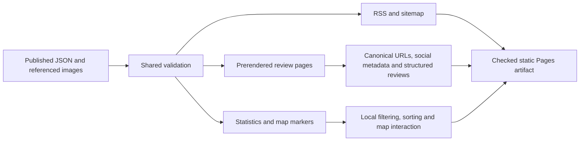

# Static architecture and rule ownership

## Data flow

Published JSON and images in `content/reviews/` → content validation and image checks → build-time loaders → prerendered HTML and page data → browser hydration and local interactions.

`ReviewContent` is the editable JSON interface. `PublicReview` adds a calculated rating. There are no database identifiers, publication statuses, users, or change logs in public content. Review files own authored timestamps and credits; each soda reviewer publishes an independent JSON entry; Git owns version history. Optional saved coordinates determine map inclusion.

The `/skapa/` and `/skapa/wizard/` routes prepare one review JSON and a separate compressed WebP (at most 1,600 pixels and 500 KiB, with original metadata removed) entirely in the browser. Uploads accept JPEG, PNG, WebP, HEIC and HEIF up to 10 MiB. Native image decoding is preferred; unsupported HEIC/HEIF files use a lazy-loaded, pinned `heic-to/csp` decoder compatible with the existing hash CSP. WebP encoding prefers the native canvas encoder; browsers such as iPhone Safari that return PNG instead use a lazy-loaded, pinned `@jsquash/webp` WebAssembly encoder bundled with the site. Both paths process resized pixels locally and preserve the same output limits. The hash CSP permits `wasm-unsafe-eval` specifically for WebAssembly compilation; JavaScript `unsafe-eval` remains disabled. HEIC originals are never published. Each review has its own author, text, timestamps, favorite status, repurchase potential, price, ratings, volume, container, image and stable slug. Different authors reviewing the same soda publish separate posts. Nested review arrays are rejected by the public field allowlist; there is no automatic conversion. The generator suggests new slugs from title and author and edits existing soda reviews without changing their slug or creation date; an unmodified image is retained and a replacement gets a new WebP filename. It exposes a single purchase price. Review images live in `content/reviews/images/`; a prerendered image endpoint publishes only validated, referenced images at the existing `/images/<filename>` URLs. The generator uses the same 16:9 image component as review pages and exports adjustable horizontal/vertical focus percentages and an optional `imageZoom` multiplier (1–3, default 1) for both review pages and cards, including edits to existing images. Images scale around the saved focus point inside an overflow-clipped 16:9 frame; zoom does not alter image bytes. A JSON import button loads saved soda reviews through the shared validator, preserving their slug, image filename and creation date; invalid imports retain the current form. Published reviews can also be selected directly. Download and PR submission share validated, snapshotted review preparation and JSON formatting; browser form state is transient.

## Browser GitHub publishing

**Skicka som PR** is the primary editor action; JSON/image downloads remain unauthenticated secondary
actions. A personal access token authenticates native browser requests to `https://api.github.com`,
allowed explicitly by CSP `connect-src`. The client targets `Flawl3ssSWE/enstorlaskreview` and `main`
from shared repository configuration. Credentials stay in editor memory, are cleared on disconnect
or editor destruction, and never enter browser storage, URLs, logs, or exported content. The UI shows
the authenticated GitHub account separately from authored review credits. All editor URLs remain
outside public navigation.

Publishing inspects reviews and images at a pinned current `main` commit. It rejects slug/image
collisions, incomplete or unsafe content inspections, and edits whose published baseline changed
or disappeared. The connected editor can explicitly reload the current review and its baseline from a pinned GitHub `main` snapshot, replacing form values after prompting the user to download their changes. This works independently of site deployment. Imported edits require a matching published baseline; imports not present in GitHub
can become additions with an uploaded processed image or a validated existing repository image.
Retained images are checked for supported signatures and size. Replaced images are removed only
when no other current review references them.

The browser creates blobs, a tree based on the existing tree, one commit, a unique
`reviews/<slug>-<uuid>` branch, and a non-draft PR. It never updates `main`. Submission freezes the
form and stores progress only in memory; uncertain branch/PR responses are reconciled before retry,
and retries reuse the same branch and commit. Publication links and success messages are shown only while the form matches the submitted content and image; loading another review clears publication state. A comparison link provides recovery after a partial
submission. GitHub enforces repository authorization; Contents and Pull requests write permissions
are required and are broader than the review folders. Required PRs/checks rely on repository rules.
The editor requests native squash auto-merge for new additions by authenticated GitHub account
`Flawl3ssSWE`, after inspecting the actual PR author, base, expected head, complete file list, and
regular file modes. Other submissions remain manual. PR creation and auto-merge outcomes are tracked
separately; failures preserve the PR link and retries reuse the same PR. The existing transient
browser token enables auto-merge through GraphQL; no workflow has merge credentials. A required
read-only policy check reevaluates enabled auto-merge on PR and auto-merge-state updates. Required
checks and any human approvals still apply. Merge triggers the checked deployment, with no backend,
persistent drafts, or deployment-status polling.

## Review calculations

Soda ratings use weights in `lib/review-metadata.ts` and scoring in `lib/content/soda.ts`: sweetness is transformed to balance with an ideal of 3; carbonation measures intensity (0 = flat, 5 = very fizzy) and contributes directly with its existing 15% weight, reflecting the preference for more carbonation; runniness is descriptive while `mouthfeelMatch` rates suitability. Apply the existing 0–3 thresholds to each review's own score. Legacy soda entries without suitability retain their original five-score average. Reviewer filtering uses normalized names and a shareable homepage query parameter. Detail pages show the selected post's own scores, favorite status and repurchase potential. Optional validated `sodaId` explicitly links independent soda posts; `lib/content/related.ts` finds peers with the same ID, excludes the current slug, and sorts by author then newest date. Titles never imply identity. The route loader emits lightweight peer metadata, and prerendered links respect the base path and trailing slash. The generator defaults `sodaId` to the normalized drink title, excluding the author and bounded to 100 characters. Clearing an override restores that default. It preserves existing explicit IDs during title edits, and offers existing soda IDs or custom overrides while keeping price and scores independent. Missing IDs in imports receive the default on export; published JSON is not inferred at read time. Optional venue ratings remain separate from the soda score.

Container and volume have independent dropdowns; common volumes live in `DRINK_VOLUMES_ML`, with custom values entered in ml. `container: "Annan"` requires a validated `customContainer` label rendered as escaped text. Combined container values are rejected. LPK in `lib/utils/drink-facts.ts` uses the review's explicit `volumeMl` and single `beerPriceKr`; unknown quantities hide LPK. Energy drinks require either `caffeineMgPer100Ml` or `caffeineMgPerContainer`. Carbohydrate and protein fields likewise accept `GPer100Ml` or `GPerContainer` (one basis per nutrient). `nutrientAmounts` derives the other basis only with an explicit volume; imported JSON preserves the entered basis. The generator converts units when volume is known and clears the value on a basis switch without volume. KPL/PPL refer to carbohydrate/protein totals for that volume. `isEnergyDrink`, `isProteinDrink`, the manual `isElectrolyteDrink` flag and explicit `sugarType` combine independently in home filters; published classifications remain explicit; `suggestDrinkTypes` offers editable generator defaults from positive caffeine/protein/carbohydrates and zero carbohydrates. Overrides and existing explicit classifications take priority; changing units does not change classifications. Clearing inputs updates automatic defaults. Serving metadata (`servingMethods`, `servingTemperature`, `servedWithIce`) stays optional, independent of packaging and scores. Serving methods are a unique allowlisted array; temperature and ice remain unknown when omitted. The generator preserves them through imports/exports and review pages display them. Cards omit caffeine and align types with the author baseline. Card types share the author row and nutrients use the existing brand/price panel with reduced padding; images retain their full area and card height stays compact. These facts do not change scores. The validator continues to support legacy bar ratings and rejects mixed formats.

Statistics in `lib/content/derived.ts` keep overview figures, rating averages, and lowest/highest liter
prices alongside separate concentration and package-total records for caffeine, protein, and
carbohydrates. Nutrient records reuse `nutrientAmounts`, derive a missing basis only with an explicit
volume, retain explicit zeroes, exclude unknown quantities from each comparison, and preserve ties
before display rounding. Linked records include the review author and package volume. The statistics
page prerenders every record and its explanatory copy; no client script is needed to read them.

The root layout prerenders with trailing slashes. Dynamic review/history routes enumerate all content slugs. History pages redirect through HTML to the GitHub file history. Unknown requests use the generated styled `404.html`. All links/assets respect the configured base path.

## Rules and tests

| Rule                                                                     | Owner                                          | Verification                                      |
| ------------------------------------------------------------------------ | ---------------------------------------------- | ------------------------------------------------- |
| Public JSON fields, ratings, paths, dates, coordinates                   | `lib/content/validation.ts`                    | `validation.test.ts`                              |
| Only public legacy records and allowlisted export fields                 | `tools/migration/projection.ts`                | `validation.test.ts`                              |
| Image signatures, missing/unreferenced images, symlinks, duplicate slugs | `lib/server/content.ts`                        | `content.test.ts`                                 |
| Statistics, price ties, missing coordinates                              | `lib/content/derived.ts`                       | `derived.test.ts`                                 |
| Markdown HTML escaping                                                   | `lib/utils/review-markdown.ts`                 | Adjacent unit tests                               |
| Search URLs, static navigation, detail/images/history, privacy           | Public routes/components                       | `tests/static-site.test.ts`                       |
| Map workers, markers, acceptance lifecycle                               | `components/review-map` and `ReviewMap.svelte` | Browser map scenarios                             |
| Frozen installs, lifecycle decisions, release delay                      | pnpm configuration                             | Clean install and CI                              |
| SHA-pinned Actions, build/deploy privilege separation                    | `.github/workflows`                            | Workflow configuration tests and repository rules |

## External dependencies and trust

OpenFreeMap supplies map style/tiles only after the visitor accepts the overlay on the map page. The map never requests browser location; acceptance stays in component memory and resets when leaving the page. The site uses no analytics scripts, analytics cookies, or consent banner. Review content and code are deployed together after repository review. CI builds untrusted PRs without write credentials; only main-branch builds upload a Pages artifact. Added regular review JSON/images qualify for content validation, audit, and a production build without application/browser tests; edits, deletions, mixed changes, and uncertain comparisons retain full verification. The production build validates the whole collection. The classifier uses complete PR or push ranges and required checks remain present on every PR. The privileged deploy job runs no source-controlled scripts.

Migration credentials exist only in a local, separately installed tool. Normal builds need no secrets and can run with an empty review collection. Static CSP uses hashes; Pages response headers differ from the retired Node deployment. See README for repository settings and cutover requirements.

Favorites use the optional `favorite` boolean; legacy `recommended` remains valid content but is not displayed or counted as a favorite. The optional integer `repurchasePotential` (0–5) is separate from weighted soda ratings. Labels live in `lib/review-metadata.ts`; missing assessments are excluded from statistics. Neither field changes the overall score.

The review editor uses the same four-step guided flow on both creation routes, with an in-place full-form toggle. Editor-only requirements enforce repurchase potential, packaging, volume and price without tightening the public JSON contract. Deterministic brand, packaging and ice suggestions live in `src/lib/utils/review-suggestions.ts`; loaded values remain authoritative until their source changes, and manual overrides remain authoritative until reset. Sugar-free is the editor default when carbohydrates are absent or zero.

## Upstream adaptations (October 2026)

The fork selectively follows upstream's web improvements, preserving soda-specific content and
static hosting. `RatingMug.svelte` draws an outline cup with a striped straw and four fill states
(0–3); its adjacent number remains visible, including zero. The brand logo is unchanged. Cards keep
their review excerpts, author, soda categories, and price; venue-attribute badges are not added.

The map uses a larger responsive frame, observes frame/attribution size changes, and keeps selected
review previews above attribution and mobile safe areas. Its preview scrolls internally when space
is limited. Escape yields to open dialogs/popovers. The initial Göteborg camera, manual coordinates,
acceptance overlay, bundled worker, and marker stacking remain unchanged.

Statistics include a sum of recorded prices (one price per independent review, without multiplying
by co-author credits), average cl/kr, and a sortable brand table at the bottom of the page. The
existing price policy is retained: campaign prices remain included and labelled by the existing
explanatory copy. Average kr/l and average cl/kr are calculated per review and are not reciprocals of
one another. Unknown price/volume values do not enter the corresponding average. Alphabetical brand
rows and all statistics are prerendered; sorting is a browser enhancement.

Discovery metadata lives in `lib/content/seo.ts` and the root layout's `Seo.svelte`. Public reviews
have canonical URLs, social image metadata and escaped JSON-LD. The sitemap enumerates public
routes and validated review slugs only. Editors, demo content, history redirects and errors are
excluded from indexing; noindex is not an access control. `/llms.txt` describes public content and
its limitations without introducing tracking or external scripts. URLs respect the configured base
path and trailing-slash policy.

The postbuild step adds exact per-page JSON-LD hashes to the existing static script CSP, without
allowing inline JavaScript generally. Coverage thresholds are committed in `vite.config.ts` and
enforced on the full CI verification path; browser UI coverage remains in Playwright.

Published review photos receive build-generated 32 px previews and 480/960 px responsive WebP
variants, generated by pinned Sharp without copying source metadata. The original image endpoint
retains its exact bytes for editor exports. Only validated referenced filenames have variants;
editor blob URLs and bundled demo assets retain their original behavior. The first homepage photo
and review detail photo load eagerly, while later cards load lazily. Shared object position and zoom
keep previews and responsive photos aligned. The header uses a separately generated 80 px logo.
